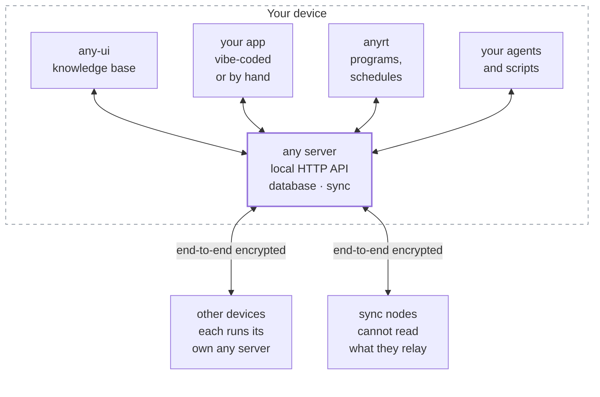

# Any

Any is an open-source, reactive, local-first database for people and LLMs
building custom software. Create collaborative apps with control over your
data and without the usual burden of backend development and maintenance.

Store documents, run Mongo-style queries, and subscribe to live updates
through a local HTTP API. Reads and writes work offline. Changes sync with
end-to-end encryption and merge automatically across devices.

Any includes hybrid search, version history, and built-in support for chat
and collaborative editing. Its companion runtime, anyrt
([anyproto/anybao](https://github.com/anyproto/anybao)), runs sandboxed
Python programs, scheduled jobs, and an agent harness alongside your data.
You choose the models and control your data and agent memory.
[Read the docs](https://docs.any.org/) to learn more.

Under the hood, Any brings together:

- Encrypted multiplayer sync powered by
  [any-sync](https://github.com/anyproto/any-sync), battle-tested across
  millions of spaces over years in production and
  [audited by Cure53](https://community.anytype.io/t/cure53-security-audit-of-anysync/31366).
- Mongo-style queries and aggregations powered by
  [any-store](https://github.com/anyproto/any-store).
- Full-text, semantic, and hybrid search, with HNSW and IVF-SQ vector indexes
  and local embeddings via llama.cpp.
- Sandboxed execution through anyrt: isolated CPython programs running on
  Wasmtime, with deterministic traces, fuel control, cron-like schedules, and
  event subscriptions.

## What you can build

- **Collaborative applications:** shared documents, chats, and workspaces
  that people can edit across devices, including offline.
- **Custom knowledge tools:** notebooks, project trackers, and searchable
  collections combining structured data and rich text.
- **Agents and automations:** programs that query shared data, preserve
  memory across sessions, and run on schedules or in response to changes.
- **Multi-agent systems and context engines:** agents that share data and
  memory, with concurrent writes merged instead of overwritten.

## How it works

Any runs a local server on each user's device. Applications connect through
a localhost HTTP API to store data, run queries, and subscribe to changes.
Several applications can share that server: they act as the same account,
read and write the same data, and a change made by one reaches the others
through their subscriptions.



Every client goes through the same HTTP API, including the `any` CLI. Only
the server opens the database and syncs with other devices. This repository
packages the server and CLI as one `any` binary, built on
[any-sync-sdk](https://github.com/anyproto/any-sync-sdk).

Data is organized into spaces: collections of objects shared with the same
members. Objects support structured properties and collaborative content.
Queries support Mongo-style filters and aggregation, while search supports
full-text, vector, and hybrid retrieval. Embeddings can run locally on your
device.

Devices exchange changes directly over peer-to-peer connections or through
sync nodes, which store and relay encrypted content without being able to
read it. When devices reconnect after working offline, CRDTs merge
concurrent edits, and version history lets applications inspect previous
changes. The underlying [any-sync protocol](https://sync.any.org/) also
powers Anytype.

The companion runtime, [anyrt](https://docs.any.org/quickstart/anyrt.html),
runs alongside the server as a separate client. It executes Python programs
in a WebAssembly sandbox with execution limits and recorded traces.
Programs, schedules, and agent memory live in the database next to the data
they work with, and the agent harness keeps long-lived sessions that retain
context across runs.

## Quickstart

> [!WARNING]
> **Developer preview.** APIs and data formats can change without migration.
> Use a separate account for experiments; do not use an account containing
> data you cannot afford to lose.

This example builds Any from source, creates a notebook, and subscribes to
changes. It uses a dedicated data directory and local embeddings.

You need Git, Go 1.26.2 or newer, `make`, `curl`, and `jq`. For release
packages and platform-specific prerequisites, see
[Installation](https://docs.any.org/quickstart/install.html).

### 1. Build

```sh
git clone https://github.com/anyproto/any.git
cd any
make build
```

The binary is written to `bin/any`. This build includes the local embedder
and downloads the llama.cpp libraries it needs. See
[Installation](https://docs.any.org/quickstart/install.html) for alternative
builds and troubleshooting.

### 2. Create an account and start the server

By default, the server joins the **production any-sync network**. To use
another network, configure it before starting the account and use a
separate data directory. See
[Networks](https://docs.any.org/quickstart/networks.html).

From the repository directory:

```sh
export ANY_DATA_DIR="$HOME/.any-demo"
export ANY_INDEX_EMBEDDER=local

./bin/any init
./bin/any run
```

`init` creates an account and prints its recovery phrase. Save it: you need
it to restore the account on another device. Running `init` again in the
same directory keeps the existing account.

Wait for `LISTENING 127.0.0.1:2046`, then leave the server running.

The local embedding model (about 600 MB) downloads in the background the
first time the server starts. You can create and query data while it
downloads.

### 3. Create a document

In a **second terminal**, create a space and a page inside it:

```sh
API=http://127.0.0.1:2046/v1

SPACE=$(curl -fsS "$API/spaces" \
  -H 'Content-Type: application/json' \
  -d '{"name":"Notebook"}' | jq -er '.id')

OBJECT=$(curl -fsS "$API/spaces/$SPACE/objects" \
  -H 'Content-Type: application/json' \
  -d '{"type":"page","initialProperties":{"any":{"name":"Reading list"}}}' \
  | jq -er '.objectId')

printf 'Created page: %s\n' "$OBJECT"
```

The `page` type gives the object an editor document. `any.name` is its title.

### 4. Query and subscribe

In the same terminal, query the pages in your space:

```sh
curl -fsS "$API/spaces/$SPACE/objects/query" \
  -H 'Content-Type: application/json' \
  -d '{"filter":{"any.type":"page"},"sort":["-modifiedAt"],"limit":20}' | jq
```

The response's `records` array includes your Reading list page. To receive
updates as the results change, subscribe to the same query:

```sh
curl -fsSN "$API/spaces/$SPACE/objects/query/subscribe" \
  -H 'Content-Type: application/json' \
  -d '{"filter":{"any.type":"page"},"sort":["-modifiedAt"],"limit":20}'
```

The stream sends `ready`, then a `snapshot` of the current records, followed
by `changes` as the results change.

Press Ctrl-C to close the subscription. To stop the server, press Ctrl-C in
the first terminal.

Continue with the [objects tutorial](https://docs.any.org/tutorial/objects.html)
to add your own properties, or follow the
[anyrt guide](https://docs.any.org/quickstart/anyrt.html) to run programs
and agents.

## Data and access

End-to-end encryption protects data exchanged between devices and sync
nodes. Local access and model providers are configured separately:

- **Local API:** the server binds to loopback and does not authenticate
  callers. Local processes can access the API as the active account.
- **Account storage:** standalone mode stores the recovery phrase and device
  key in `wallet.key`. To encrypt the wallet, set `ANY_WALLET_PASSKEY` before
  initializing the account and supply the same passkey when starting the
  server.
- **Second devices:** restore from the recovery phrase with
  `./bin/any init --mnemonic-stdin`. Do not copy `wallet.key`: that also
  copies the device identity and interferes with sync.
- **Data location:** this example uses `~/.any-demo/`; the normal default is
  `~/.any/`. Treat the directory as private account data.
- **Embeddings and models:** this example explicitly selects local
  embeddings. Configured remote embedding providers receive embedding
  inputs. The agent's model provider is configured separately; local
  embeddings do not make agent model calls local.

See [Server lifecycle](docs/02-server.md), [Configuration](docs/05-config.md),
and [Embedders](https://docs.any.org/search/embedders.html) for details.

## Documentation

Visit [docs.any.org](https://docs.any.org/) for the full documentation.

- [Tutorial](https://docs.any.org/tutorial/) — objects, properties, datasets,
  and apps.
- [Programs and agents](https://docs.any.org/quickstart/anyrt.html) — set up
  the companion runtime.
- [Client guide](docs/29-client-model.md) — types, property IDs, and the
  catalog.
- [HTTP API](docs/03-api.md) and [CLI](docs/01-cli.md) — requests and
  commands.
- [Live queries](docs/04-events.md) — snapshots, updates, and reconnect
  behavior.
- [Technical overview](docs/00-overview.md) — architecture and the complete
  documentation index.

We welcome [bug reports and feedback](https://github.com/anyproto/any/issues).

## License

Any is open source under the [MIT license](LICENSE). You can use, modify, and
distribute it in personal and commercial applications, provided you retain
the copyright and license notice. Third-party dependencies and models retain
their respective licenses.
